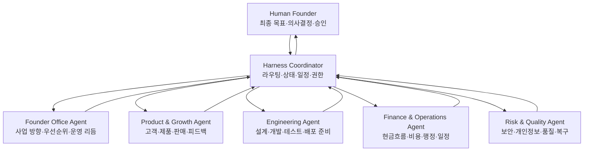
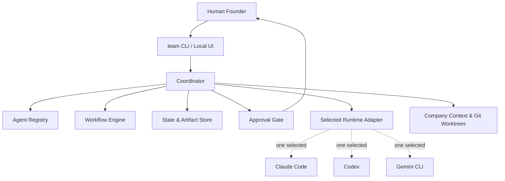

# 1인 AI 창업을 위한 Agent-Team Harness 설계서

> Claude Code · OpenAI Codex · Gemini CLI 중 사용자가 선택한 Coding Agent 위에서 실행되는 최소 가상 조직  
> 작성일: 2026-11-13  
> 상태: 설계 v2.1

## 1. 전제 바로잡기

이 설계는 Claude Code, Codex, Gemini CLI를 동시에 사용하는 멀티 LLM 시스템이 아니다.

세 도구는 사용자가 선택할 수 있는 교체 가능한 **Coding Agent Runtime**이다. Agent-Team Harness는 선택된 런타임 위에서 여러 업무 역할의 Agent를 별도 세션으로 실행한다.

```text
사용자가 선택한 Runtime
  ├─ Claude Code
  ├─ Codex
  └─ Gemini CLI
         ↓ 하나를 선택
Agent-Team Harness
  ├─ Founder Office Agent
  ├─ Product & Growth Agent
  ├─ Engineering Agent
  ├─ Finance & Operations Agent
  └─ Risk & Quality Agent
```

예를 들어 사용자가 Codex를 선택했다면 다섯 역할 모두 Codex 세션으로 실행된다. Claude Code를 선택했다면 같은 역할과 업무 프로토콜이 Claude Code 세션으로 실행된다.

핵심은 모델 다양성이 아니라 다음 세 가지다.

1. 1인 창업자가 놓치기 쉬운 필수 업무를 역할로 분리한다.
2. 각 역할의 책임·산출물·권한을 고정한다.
3. 어떤 Coding Agent를 선택해도 같은 팀 운영 방식을 제공한다.

## 2. 목표

Agent-Team Harness의 목표는 1인 창업자를 대신하는 완전자율 회사를 만드는 것이 아니다.

목표는 창업자가 제품을 만들고 판매하는 동안 다음 필수 기능이 사라지지 않게 만드는 것이다.

- 사업 방향과 우선순위
- 고객 문제와 제품 요구사항
- 개발과 기술 부채
- 고객 확보와 피드백
- 현금흐름과 운영 일정
- 보안·개인정보·품질 위험

Harness는 이 기능들을 최소 역할로 묶고, 필요한 시점에 Agent를 호출하고, 결과를 공통 회사 기록에 남기며, 중요한 결정은 창업자에게 올린다.

### 성공 기준

- 창업자가 하나의 목표를 주면 필요한 역할만 자동 선택된다.
- 각 Agent의 결과가 정해진 문서와 작업 보드에 남는다.
- 같은 사실을 Agent마다 다르게 기억하지 않는다.
- 재무·보안·고객 업무가 개발에 밀려 장기간 방치되지 않는다.
- 외부 발송, 지출, 계약, 배포 등 중요한 행동은 사람이 승인한다.
- 사용자가 Coding Agent를 바꿔도 회사 기록과 업무 흐름은 유지된다.

### 비목표

- 여러 LLM의 답을 투표로 합치는 것
- 모든 업무에 모든 Agent를 참여시키는 것
- AI가 법률·세무·회계 전문가를 대체하는 것
- AI가 사람 대신 계약하거나 돈을 이동하는 것
- 처음부터 완전자율 운영을 구현하는 것
- 실제 직원 조직도를 그대로 복제하는 것

## 3. 설계 근거

### 3.1 역할은 나누되 조직은 작게 유지한다

MetaGPT와 ChatDev는 서로 다른 역할을 가진 Agent가 정해진 절차와 산출물을 통해 협업하는 패턴을 제시했다. 여기서 가져올 것은 많은 가상 직책이 아니라 **역할별 책임과 구조화된 인계**다. [MetaGPT](https://arxiv.org/abs/2308.00352), [ChatDev](https://arxiv.org/abs/2307.07924)

반면 최근 에이전트 시스템 연구에서는 순차적인 작업에 Agent를 과도하게 추가하면 조정 비용과 오류가 증가할 수 있다고 지적한다. 따라서 이 설계는 상시 활동하는 큰 조직이 아니라 5개 필수 기능과 작업별 선택 호출을 사용한다. [Towards a Science of Scaling Agent Systems](https://arxiv.org/abs/2512.08296), [Why Do Multi-Agent LLM Systems Fail?](https://arxiv.org/abs/2503.13657)

### 3.2 1인 사업도 재무 기능은 생략할 수 없다

소규모 사업 운영 지침은 기본 장부, 현금, 채권·채무, 비용, 현금흐름 전망을 지속적으로 관리해야 한다고 강조한다. Agent가 회계사를 대체할 수는 없지만, 숫자를 정리하고 누락을 경고하고 전문가에게 전달할 자료를 준비하는 역할은 할 수 있다. [SBA Manage Your Business](https://www.sba.gov/counseling/manage-your-business/)

### 3.3 보안은 별도 대형팀이 아니라 최소 통제와 정기 점검으로 시작한다

NIST는 직원이 없는 1인 사업자도 자산 파악, MFA, 업데이트, 백업, 접근 통제, 사고 대응 연락처 같은 기본적인 보안 관리가 필요하다고 설명한다. Risk Agent는 보안 조직을 흉내 내는 것이 아니라 이러한 최소 통제를 놓치지 않게 한다. [NIST Solopreneur Guide](https://csrc.nist.gov/pubs/cswp/50/small-business-cybersecurity-non-employer-firms/final), [NIST CSF 2.0 Small Business Quick Start](https://csrc.nist.gov/pubs/sp/1300/final)

### 3.4 Agent 수보다 검증 가능한 업무 흐름이 중요하다

Agentless와 AI Agents That Matter는 복잡한 에이전트 구조보다 단순하고 재현 가능한 절차, 비용과 품질을 함께 보는 평가가 중요하다고 지적한다. 따라서 각 Agent는 자유롭게 회사를 운영하지 않고 정해진 workflow와 output contract 안에서 일한다. [Agentless](https://arxiv.org/abs/2407.01489), [AI Agents That Matter](https://arxiv.org/abs/2407.01502)

## 4. 최소 조직 구성

권장 최소 구성은 **5개 Agent + 사람 창업자 + 결정론적 Harness**다.



### 사람 창업자

사람은 팀의 구성원이 아니라 최종 책임자다.

사람에게 남겨야 하는 결정:

- 어떤 고객 문제를 해결할지
- 사업의 가치와 윤리 기준
- 가격과 포지셔닝
- 지출·계약·세금·법적 판단
- 외부 공개와 고객 커뮤니케이션
- 프로덕션 배포와 데이터 삭제
- Agent 의견이 충돌할 때의 최종 결정

### Harness Coordinator

Coordinator는 Agent가 아니라 일반 프로그램이다.

- 사용자 요청을 workflow로 라우팅
- 필요한 Agent만 선택
- Agent 세션 실행과 중단
- 입력과 결과 schema 검증
- 공유 문서의 쓰기 소유권 관리
- 승인 대기
- 일정 작업 실행
- 작업 이력과 evidence 보존

Coordinator가 사업적 판단을 하지 않는다. 판단은 역할 Agent가 제안하고 사람에게 전달한다.

## 5. Agent 역할 정의

### 5.1 Founder Office Agent

### 존재 이유

개발에 몰입한 창업자가 목표·우선순위·성과를 잃지 않게 한다. 전통적인 조직의 CEO staff, 사업기획, 프로젝트 관리 일부를 합친 역할이다.

### 책임

- 회사 목표와 현재 단계 정리
- 주간 우선순위 제안
- Agent 간 업무 라우팅 제안
- 진행 중 작업과 blocker 요약
- 주요 결정에 필요한 선택지 정리
- 주간·월간 운영 보고서 작성
- 결정 기록 관리

### 주요 입력

- 창업자의 목표와 제약
- 고객·제품 Agent의 학습
- Engineering 진행 상황
- Finance 현금흐름 요약
- Risk 위험 목록

### 주요 산출물

- `company/strategy.md`
- `company/goals.md`
- `company/weekly-plan.md`
- `company/weekly-review.md`
- `company/decisions/*.md`

### 하지 말아야 할 일

- 창업자 승인 없이 전략을 확정하지 않음
- 다른 Agent의 전문 문서를 직접 수정하지 않음
- 여러 Agent에게 같은 작업을 중복 배정하지 않음
- 진행률을 근거 없이 낙관적으로 보고하지 않음

### 호출 시점

- 새로운 사업 목표 입력
- 주간 계획과 회고
- Agent 간 우선순위 충돌
- 중요한 의사결정 준비

### 5.2 Product & Growth Agent

### 존재 이유

제품 기획, 고객 조사, 마케팅, 판매, 고객지원은 모두 고객과 시장에 대한 하나의 학습 루프다. 1인 사업에서는 이를 별도 부서로 나누기보다 하나의 Agent로 합친다.

### 책임

- 고객 문제와 대상 고객 정의
- 인터뷰·문의·지원 티켓 분석
- 경쟁 제품과 대안 조사
- 제품 요구사항과 수용 조건 작성
- 가치 제안과 가격 가설 제안
- 랜딩 페이지·메일·콘텐츠 초안
- 유입→활성화→결제→유지 지표 분석
- 실험 설계와 결과 기록

### 주요 입력

- 고객 대화와 지원 기록
- 분석 지표
- 창업자의 아이디어
- Engineering의 기술 제약
- Finance의 가격·비용 정보

### 주요 산출물

- `company/product.md`
- `company/customers.md`
- `company/roadmap.md`
- `company/experiments/*.md`
- `work/specs/*.md`
- `work/content-drafts/*.md`

### 하지 말아야 할 일

- 고객에게 자동 발송하지 않음
- 근거 없는 시장 규모와 성과 수치를 만들지 않음
- 제품 요구사항을 Engineering 검토 없이 확정하지 않음
- 가격 변경이나 광고비 지출을 실행하지 않음

### 호출 시점

- 아이디어 검증
- 신규 기능 제안
- 고객 피드백 유입
- 가격·메시지·채널 실험
- 릴리스 설명과 고객 커뮤니케이션 준비

### 5.3 Engineering Agent

### 존재 이유

제품을 실제로 설계·구현·검증하고 운영 가능한 상태로 만든다. 개발자, 아키텍트, QA 자동화, DevOps의 필수 부분을 합친다.

### 책임

- 코드베이스 분석
- 기술 설계와 작업 분해
- 코드와 테스트 구현
- 기술 부채 기록
- 빌드·테스트·정적 검사 실행
- 배포 계획과 rollback 절차 준비
- 장애 원인 조사와 수정안 제시
- 기술 문서와 변경 기록 유지

### 내부 임시 역할

큰 개발 작업에서는 Engineering Agent가 Harness를 통해 다음 임시 세션으로 분리될 수 있다.

- Planner: 읽기 전용 설계
- Implementer: worktree 작성
- Reviewer: 읽기 전용 diff 검토

이들은 영구 조직 Agent가 아니라 한 개발 workflow 안에서만 존재한다.

### 주요 입력

- 승인된 제품 spec
- 아키텍처와 저장소 지침
- Risk Agent의 보안 요구사항
- 운영 장애와 로그

### 주요 산출물

- 코드 branch와 commit
- 테스트 결과
- `company/architecture.md`
- `work/engineering/*.md`
- `work/releases/*.md`
- 기술 부채 항목

### 하지 말아야 할 일

- 제품 spec을 임의로 확대하지 않음
- 승인 없이 프로덕션 배포하지 않음
- 테스트 실패를 성공으로 보고하지 않음
- 비밀정보를 코드·로그·문서에 기록하지 않음
- Risk finding을 근거 없이 무시하지 않음

### 호출 시점

- 기능 구현
- 버그·장애 처리
- 기술 검토
- 릴리스 준비
- 기술 부채·의존성 관리

### 5.4 Finance & Operations Agent

### 존재 이유

1인 사업에서 가장 쉽게 미뤄지는 현금흐름, 비용, 청구, 세무 일정, 공급자 계약을 정리한다. 회계사나 세무사를 대체하지 않고 전문가와 창업자가 판단할 수 있는 자료를 준비한다.

### 책임

- 수입·지출 분류 초안
- 현금 잔액과 runway 계산
- 반복 비용·미사용 구독 점검
- 매출, 환불, 미수금, 지급 예정 요약
- 월별 예산 대비 실제 비용 분석
- 가격별 단위경제성 계산
- 세금·신고·계약 갱신 일정 알림
- 외부 전문가에게 전달할 자료와 질문 정리

### 주요 입력

- 은행·결제·회계 시스템의 읽기 전용 export
- 인보이스와 영수증
- 공급자 구독 내역
- Product Agent의 가격 가설
- Engineering의 인프라 비용

### 주요 산출물

- `company/finance/monthly-summary.md`
- `company/finance/cashflow.csv`
- `company/finance/runway.md`
- `company/finance/obligations.md`
- 비용 이상 징후와 확인 질문

### 하지 말아야 할 일

- 돈을 이동하거나 결제를 승인하지 않음
- 세금 신고·회계 분개를 확정하지 않음
- 법률·세무 자문인 것처럼 단정하지 않음
- 출처가 없는 숫자를 사용하지 않음
- 계좌 credential과 전체 카드 정보를 저장하지 않음

### 호출 시점

- 주간 현금·비용 이상 확인
- 월말 결산 준비
- 가격 변경 검토
- 큰 지출·신규 공급자 검토
- 세무·계약 일정 임박

### 5.5 Risk & Quality Agent

### 존재 이유

전담 보안팀을 둘 수 없는 1인 사업에서도 보안, 개인정보, 신뢰성, 복구 준비는 필요하다. 이 Agent는 모든 것을 차단하는 감사자가 아니라 최소 안전선과 release gate를 관리한다.

### 책임

- 중요 자산·데이터·외부 서비스 목록 유지
- 인증·권한·비밀정보·개인정보 변경 검토
- 의존성·취약점·백업 상태 점검
- release 전 위험 기반 검토
- 사고 대응 절차와 연락처 유지
- 데이터 보존·삭제·접근 원칙 점검
- 테스트 누락과 운영 복구 가능성 검토
- risk register 관리

### NIST 기반 최소 범위

- Govern: 책임, 외부 전문가, 기본 정책
- Identify: 자산, 데이터, 공급자 목록
- Protect: MFA, 최소 권한, 업데이트, 백업, 암호화
- Detect: 로그, 비용·접근 이상 징후
- Respond: 사고 분류, 연락처, 고객 커뮤니케이션 초안
- Recover: 복원 절차, backup test, rollback

### 주요 입력

- 제품 spec과 데이터 흐름
- Engineering diff와 배포 계획
- 사용하는 SaaS·cloud·payment 목록
- 보안 스캔과 의존성 보고서
- 장애·사고 기록

### 주요 산출물

- `company/risk/register.md`
- `company/risk/security-baseline.md`
- `company/risk/data-inventory.md`
- `company/risk/incident-plan.md`
- release review 결과

### 하지 말아야 할 일

- 모든 작업을 일률적으로 차단하지 않음
- 자동으로 credential을 교체하거나 계정을 정지하지 않음
- 법적 준수를 보증하지 않음
- 근거 없이 취약점을 확정하지 않음
- 실제 침해사고의 외부 공지를 자동 발송하지 않음

### 호출 시점

- 인증·결제·개인정보·파일 업로드 변경
- 인프라·권한·비밀정보 변경
- release 전 위험 검토
- 월간 보안 기본 점검
- 장애·침해 의심

## 6. 왜 5개인가

다음 기능은 없어지면 사업이 한쪽으로 기울기 때문에 반드시 필요하다.

| 기능 | 담당 Agent | 빠졌을 때 생기는 문제 |
|---|---|---|
| 방향·우선순위 | Founder Office | 중요하지 않은 개발에 시간 소모 |
| 고객·제품·매출 | Product & Growth | 만들기만 하고 팔지 못함 |
| 제품 구현 | Engineering | 제품과 운영 개선 불가 |
| 현금·행정 | Finance & Operations | 현금 부족, 비용 누수, 일정 누락 |
| 보안·품질·복구 | Risk & Quality | 사고, 데이터 손실, 신뢰 하락 |

더 줄일 경우 Finance와 Risk가 다시 개발·영업에 묻힐 가능성이 높다. 더 늘릴 경우 1인 사업에서는 조정 비용이 실제 업무보다 커질 수 있다.

법무, HR, 데이터, 디자인, QA, DevOps, 고객지원은 독립 Agent로 두지 않는다.

- 법무·세무: Finance/Risk가 자료를 준비하고 외부 전문가에게 escalation
- 디자인: Product & Growth의 임시 specialist mode
- QA·DevOps: Engineering workflow 내부 임시 역할
- 데이터 분석: Product 또는 Finance가 목적에 따라 담당
- 고객지원: Product & Growth가 고객 학습 루프로 담당
- HR: 직원이 생기기 전에는 범위 밖

## 7. Coding Agent Runtime 추상화

### 7.1 핵심 원칙

Agent 역할 정의는 Coding Agent와 독립적이어야 한다.

```text
Role Definition
  + Shared Company Context
  + Task Contract
  + Tool Policy
       ↓ compile
Claude Code | Codex | Gemini CLI invocation
```

### Runtime 선택

```text
team init --runtime claude
team init --runtime codex
team init --runtime gemini

team runtime set codex
```

한 workflow 안에서는 기본적으로 하나의 Runtime만 사용한다. Runtime을 바꾸면 새로운 세션을 만들되, 회사 문서와 task history를 통해 연속성을 유지한다.

### 공통 Adapter

```ts
type RuntimeName = 'claude' | 'codex' | 'gemini';

interface AgentSessionRequest {
  agentId: string;
  roleFile: string;
  taskFile: string;
  cwd: string;
  readOnly: boolean;
  timeoutMs: number;
}

interface CodingAgentRuntime {
  name: RuntimeName;
  probe(): Promise<RuntimeCapabilities>;
  start(request: AgentSessionRequest): AsyncIterable<TeamEvent>;
  resume(sessionId: string, message: string): AsyncIterable<TeamEvent>;
  interrupt(sessionId: string): Promise<void>;
}
```

### Claude Code Adapter

```text
claude -p --output-format stream-json --json-schema <schema> <prompt>
```

### Codex Adapter

```text
codex exec --json --output-schema <schema> -
```

### Gemini CLI Adapter

```text
gemini -p <prompt> --output-format stream-json
```

각 CLI의 실제 flag는 `team doctor`가 현재 버전에서 확인한다. Harness는 모델 이름이나 공급자별 내부 subagent 기능을 역할 정의에 포함하지 않는다.

### 7.2 Native subagent 기능의 위치

Claude Code, Codex, Gemini CLI의 native subagent 기능은 선택적 최적화다.

- 팀의 업무 역할은 Harness가 정의한다.
- 팀원 하나는 기본적으로 독립 CLI 세션이다.
- Runtime이 안정적인 subagent 기능을 제공하면 Engineering 내부 임시 역할 등에 사용할 수 있다.
- business Agent 구성은 native subagent 구현에 종속되지 않는다.

이렇게 해야 Coding Agent를 바꿔도 조직 설계가 유지된다.

## 8. Agent 정의 형식

각 Agent는 YAML metadata와 Markdown instructions로 정의한다.

```text
agents/
├── founder-office/
│   ├── agent.yaml
│   └── instructions.md
├── product-growth/
├── engineering/
├── finance-ops/
└── risk-quality/
```

예시:

```yaml
id: finance-ops
name: Finance & Operations
description: 현금흐름, 비용, 행정 의무를 추적하고 창업자에게 경고한다.

triggers:
  events:
    - expense.created
    - pricing.review_requested
  schedules:
    - weekly
    - monthly_close

context:
  read:
    - company/goals.md
    - company/finance/**
    - company/metrics/**
  write:
    - company/finance/**

tools:
  allow:
    - filesystem.read
    - filesystem.write_scoped
    - spreadsheet
    - calculator
  deny:
    - payment.execute
    - bank.transfer
    - tax.submit

outputs:
  schema: schemas/finance-report.schema.json

approval:
  required_for:
    - external_write
    - financial_commitment
```

## 9. 공유 회사 컨텍스트

Agent끼리 전체 대화 내역을 전달하지 않는다. 검증 가능한 회사 문서와 task artifact를 공유한다.

```text
company/
├── charter.md
├── strategy.md
├── goals.md
├── product.md
├── customers.md
├── roadmap.md
├── metrics/
│   ├── product.md
│   └── business.md
├── finance/
│   ├── cashflow.csv
│   ├── runway.md
│   ├── obligations.md
│   └── monthly-summary.md
├── risk/
│   ├── register.md
│   ├── security-baseline.md
│   ├── data-inventory.md
│   └── incident-plan.md
├── architecture.md
├── decisions/
└── weekly/

work/
├── inbox/
├── specs/
├── tasks/
├── reviews/
├── releases/
└── archive/
```

### 문서 소유권

| 문서 | 주 소유자 | 검토자 |
|---|---|---|
| `strategy.md`, `goals.md` | Founder Office | 사람 창업자 |
| `product.md`, `customers.md`, `roadmap.md` | Product & Growth | Founder Office |
| `architecture.md`, release 문서 | Engineering | Risk & Quality |
| `finance/**` | Finance & Operations | 사람 창업자·외부 전문가 |
| `risk/**` | Risk & Quality | Engineering·사람 창업자 |
| `decisions/**` | Founder Office | 사람 창업자 |

모든 Agent가 모든 문서를 수정할 수 있게 하지 않는다. 읽기는 넓게, 쓰기는 역할 소유 범위로 제한한다.

## 10. 업무 라우팅

모든 작업에 모든 Agent를 참여시키지 않는다.

| 작업 유형 | 필수 Agent | 조건부 Agent | 최종 승인 |
|---|---|---|---|
| 아이디어 검증 | Product & Growth | Founder Office, Finance | 사람 |
| 주간 우선순위 | Founder Office | 모든 Agent의 상태 요약 | 사람 |
| 일반 기능 개발 | Product & Growth → Engineering | Risk | 사람 merge |
| 인증·결제·개인정보 기능 | Product & Growth → Engineering → Risk | Finance | 사람 release |
| 가격 변경 | Product & Growth + Finance | Founder Office | 사람 |
| 마케팅 콘텐츠 | Product & Growth | Risk if claims/privacy | 사람 게시 |
| 비용·구독 검토 | Finance & Operations | Engineering | 사람 해지·결제 |
| 일반 release | Engineering | Risk based on score | 사람 배포 |
| 보안·장애 incident | Engineering + Risk | Product for communication | 사람 대응 승인 |
| 월말 운영 | Finance + Founder Office | Product metrics | 사람 검토 |

### 위험 점수 기반 Risk 호출

다음 중 하나라도 포함되면 Risk & Quality Agent를 호출한다.

- 인증·인가
- 결제·환불
- 개인정보·고객 데이터
- 파일 업로드·다운로드
- 외부 API credential
- 인프라·네트워크·권한
- 데이터베이스 migration·삭제
- 공개적인 보안 주장
- backup·restore·rollback 영향

그 외의 단순 UI·문서·저위험 버그 수정에는 Risk Agent를 호출하지 않는다.

## 11. 핵심 Workflow

### 11.1 아이디어 검증

```text
사람: 아이디어와 가정 입력
  ↓
Product & Growth: 고객·문제·대안·검증 실험 제안
  ↓
Finance & Operations: 가격·비용·runway 영향 검토
  ↓
Founder Office: 선택지와 미확인 가정 정리
  ↓
사람: 실험/보류/폐기 결정
```

필수 산출물:

- 고객과 문제 정의
- 기존 대안
- 가장 위험한 가정
- 1~2주 안에 가능한 검증 실험
- 최대 허용 비용
- 성공·실패 기준

### 11.2 기능 개발

```text
Product & Growth: spec + acceptance criteria
  ↓
Engineering: plan → implementation → tests
  ↓
Risk & Quality: 조건부 review
  ↓
Founder Office: 목표·범위 일치 확인
  ↓
사람: merge/release 승인
```

Engineering 내부에서는 필요 시 별도 worktree의 Planner, Implementer, Reviewer 세션을 사용한다.

### 11.3 고객 피드백 루프

```text
고객 대화·지원 문의·사용 지표
  ↓
Product & Growth: 주제·빈도·심각도·고객군 분류
  ↓
Founder Office: 기존 목표와 비교
  ↓
Engineering: 기술 난이도와 영향 추정
  ↓
사람: roadmap 반영 여부 결정
```

고객 답변은 초안까지만 자동화하며 외부 발송은 승인받는다.

### 11.4 주간 운영

```text
월요일
  각 Agent가 자신의 영역에서 변화·위험·다음 행동을 제출
  Founder Office가 주간 계획 초안 작성
  사람이 이번 주 목표 1~3개 승인

주중
  Harness가 목표별 workflow 실행
  blocker와 승인 요청만 사람에게 알림

금요일
  결과·지표·비용·위험 요약
  계속/중단/변경할 실험 제안
  사람이 회고와 다음 주 방향 확정
```

주간 보고서는 다음 한 페이지를 넘기지 않는 것을 기본으로 한다.

- 이번 주 목표와 결과
- 고객에게서 배운 것
- 제품·개발 변화
- 매출·현금·비용 변화
- 새 위험과 해결 상태
- 필요한 결정
- 다음 주 후보 3개

### 11.5 월말 운영

```text
Finance: 매출·지출·현금·runway·의무 요약
Product: acquisition·activation·retention 학습
Engineering: reliability·tech debt·infra cost
Risk: 자산·접근·backup·dependency 점검
Founder Office: 월간 운영 리뷰
사람: 다음 달 목표와 예산 승인
```

### 11.6 Incident

```text
Detect
  ↓
Engineering: 기술 영향·완화안
Risk: 데이터·보안·복구·증거 보존
Product & Growth: 고객 영향과 공지 초안
Founder Office: 의사결정 항목 정리
사람: 조치·외부 공지 승인
```

Incident 중에는 Agent가 외부 공지, 계정 차단, 데이터 삭제를 자동 실행하지 않는다.

## 12. 작업 계약과 인계

### Task Contract

```yaml
id: TASK-042
goal_id: GOAL-2026-11-01
requested_by: founder
owner_agent: engineering

objective: 조직별 API key를 생성하고 폐기할 수 있게 한다.
why: B2B 고객의 자동화 연동을 지원한다.

inputs:
  - work/specs/api-keys.md
  - company/architecture.md

scope:
  writable_paths:
    - apps/api/**
    - apps/web/**
  forbidden_actions:
    - production.deploy
    - database.delete

acceptance:
  - non-admin cannot create keys
  - raw key is shown only once
  - audit log is written

checks:
  - pnpm test api-keys
  - pnpm lint

risk_flags:
  - authentication
  - secrets

approval:
  required_for:
    - merge
    - release
```

### Handoff Contract

```json
{
  "task_id": "TASK-042",
  "agent_id": "engineering",
  "status": "ready_for_review",
  "summary": "API key 생성·폐기와 권한 테스트를 구현했다.",
  "artifacts": ["branch:agent-team/TASK-042"],
  "evidence": [
    { "check": "pnpm test api-keys", "exit_code": 0 }
  ],
  "decisions": [],
  "assumptions": [],
  "risks": ["Rate limiting은 별도 작업"],
  "requested_next_agent": "risk-quality"
}
```

Agent 전체 대화는 인계하지 않는다. 후속 Agent는 원본 task, 회사 문서, artifact, handoff만 받는다.

## 13. 권한과 승인

### Agent가 자율적으로 할 수 있는 일

- 저장소와 승인된 회사 문서 읽기
- 소유 문서 범위 안에서 초안 작성
- 별도 branch/worktree에서 코드 수정
- 테스트와 분석 실행
- 내부 task와 finding 생성
- 사람에게 선택지와 경고 제출

### 반드시 사람 승인이 필요한 일

- 돈 지출·이체·환불
- 가격 변경
- 계약 서명·해지
- 세금·법률 문서 제출
- 고객·대중에게 메시지 발송
- 광고·캠페인 게시
- 프로덕션 배포
- 데이터 삭제·migration 실행
- credential 생성·폐기·회전
- 보안 사고 외부 공지
- roadmap와 사업 전략 확정

### 외부 전문가 escalation

다음은 Agent가 결론을 내리지 않고 자료를 정리해 전문가에게 넘긴다.

- 세금 신고와 회계 처리
- 계약·이용약관·개인정보 법률 판단
- 침해사고 법적 통지 의무
- 규제 산업의 준수 여부
- 보험·투자·대출 관련 판단

## 14. Harness 아키텍처



### 구성 요소

| 구성 요소 | 책임 |
|---|---|
| CLI/UI | 목표 제출, 상태 확인, 승인 |
| Coordinator | 실행·라우팅·timeout·결과 취합 |
| Agent Registry | 역할, prompt, 도구, 문서 권한 |
| Workflow Engine | task DAG, schedule, gate |
| Runtime Adapter | 선택한 Coding Agent 실행 |
| State Store | task, session, event, approval |
| Artifact Store | 회사 문서, 보고서, 코드 branch |
| Approval Gate | 중요 행동의 사람 승인 |

### 권장 기술

- Node.js 22 + TypeScript
- SQLite
- JSONL event log
- YAML Agent·workflow 정의
- Zod + JSON Schema
- `execa` subprocess runner
- Git worktree for Engineering
- cron 또는 단순 scheduler for weekly/monthly workflows

## 15. 저장소 구조

```text
agent-team/
├── src/
│   ├── cli/
│   ├── coordinator/
│   ├── workflows/
│   ├── approvals/
│   ├── runtime/
│   │   ├── types.ts
│   │   ├── claude.ts
│   │   ├── codex.ts
│   │   └── gemini.ts
│   └── store/
├── agents/
│   ├── founder-office/
│   ├── product-growth/
│   ├── engineering/
│   ├── finance-ops/
│   └── risk-quality/
├── workflows/
│   ├── idea-validation.yaml
│   ├── feature-delivery.yaml
│   ├── customer-feedback.yaml
│   ├── weekly-operations.yaml
│   ├── monthly-close.yaml
│   └── incident.yaml
├── schemas/
├── company/
├── work/
├── .agent-team/
│   ├── state.db
│   ├── runs/
│   └── worktrees/
├── agent-team.yaml
└── package.json
```

## 16. Workflow 정의 예시

```yaml
id: feature-delivery
name: Feature Delivery

trigger:
  command: feature

steps:
  - id: product_spec
    agent: product-growth
    output: work/specs/${task_id}.md

  - id: founder_scope_gate
    type: approval
    requires: product_spec

  - id: engineering
    agent: engineering
    requires: founder_scope_gate

  - id: risk_review
    agent: risk-quality
    when: task.risk_flags.length > 0
    requires: engineering

  - id: release_gate
    type: approval
    requires:
      - engineering
      - risk_review?
```

Workflow는 Agent가 다음 역할을 즉흥적으로 정하게 하지 않는다. Harness가 어떤 Agent를 언제 호출할지 정의한다.

## 17. CLI 설계

```text
team init --runtime <claude|codex|gemini>
team doctor
team runtime show
team runtime set <runtime>

team goal create
team task create
team run <workflow> [task-id]
team ask <agent-id> <request>

team status
team inbox
team inspect <run-id>
team logs <run-id>
team approve <approval-id>
team reject <approval-id> --reason <text>

team weekly
team monthly
team risks
team finance
team clean
```

### 사용 예시

```text
# Codex 기반으로 팀 초기화
team init --runtime codex

# 아이디어 검증
team run idea-validation "개발자를 위한 API 비용 모니터링 SaaS"

# 기능 개발
team run feature-delivery TASK-042

# 주간 운영 회의
team weekly

# Runtime 교체
team runtime set claude
team doctor
```

## 18. 알림과 Human Inbox

Agent가 생성한 모든 내용을 사람이 읽게 하면 하네스가 오히려 부담이 된다. 사람에게 올리는 항목을 제한한다.

### 즉시 알림

- 업무가 사람 입력 없이는 진행 불가
- 지출·배포·외부 발송 승인
- 높은 보안·개인정보 위험
- cash runway 기준 이하
- 고객 영향 incident
- Agent 간 중요한 사실 충돌

### 주간 요약으로 충분한 항목

- 일반 진행 상태
- 낮은 우선순위 기술 부채
- 정상적인 비용 변화
- 신규 아이디어 후보
- low severity risk

### Inbox 항목 형식

```yaml
id: APPROVAL-019
type: release
requested_by: engineering
summary: API key 기능을 production에 배포합니다.
why_now: 모든 acceptance check와 risk review 통과
evidence:
  - work/releases/TASK-042.md
  - work/reviews/TASK-042-risk.md
options:
  - approve
  - reject
  - request_changes
expires_at: 2026-11-15T09:00:00+09:00
```

## 19. 운영 리듬

Agent가 항상 실행될 필요는 없다. 최소 호출 주기는 다음과 같다.

| Agent | Event 기반 | 정기 실행 |
|---|---|---|
| Founder Office | 목표·결정·blocker | 매주 |
| Product & Growth | 피드백·기능·캠페인 | 매주 고객 학습 요약 |
| Engineering | 개발·장애·release | dependency 점검 주 1회 |
| Finance & Operations | 지출·매출·계약 | 주간 현금, 월말 close |
| Risk & Quality | 위험 flag·incident·release | 월간 baseline 점검 |

초기에는 scheduler가 문서를 자동 변경하지 않고 task 초안을 생성하도록 한다. 사용자가 승인한 뒤 Agent를 실행한다.

## 20. 2주 MVP 구현 계획

### 1~2일: 기반과 Runtime

- TypeScript CLI 초기화
- 공통 Runtime Adapter
- Claude/Codex/Gemini probe와 headless 실행
- 선택된 Runtime 저장
- JSONL event 보존

완료 조건:

- `team init --runtime ...`가 동작한다.
- 세 Runtime 중 선택한 하나로 임의 Agent session을 실행할 수 있다.

### 3일: Agent Registry

- 5개 Agent metadata
- 역할 instructions
- 문서 read/write scope
- output schema

완료 조건:

- `team ask finance-ops ...`가 Finance 역할과 제한된 컨텍스트로 실행된다.

### 4일: 회사 Context

- `company/`, `work/` template
- 문서 소유권 검사
- decision과 evidence link
- Runtime 변경 후 새 세션에서 context 복원

완료 조건:

- Runtime을 바꿔도 Agent가 동일한 회사 상태를 읽는다.

### 5일: Task와 Handoff

- Task contract
- Agent result/handoff schema
- run/session/event store
- 상태 머신

완료 조건:

- 한 Agent의 결과를 대화 전체가 아닌 handoff로 다음 Agent에게 전달한다.

### 6일: Workflow Engine

- YAML workflow loader
- step dependency
- conditional Agent 호출
- failure와 retry 1회

완료 조건:

- idea-validation workflow가 세 역할을 순서대로 실행한다.

### 7일: Approval Gate

- human inbox
- approve/reject/request_changes
- 승인 전 외부 action 차단
- approval과 artifact hash 연결

완료 조건:

- workflow가 승인 step에서 안전하게 멈추고 재개된다.

### 8일: Engineering Worktree

- Git worktree 생성
- Planner/Implementer/Reviewer 임시 세션
- test command와 diff evidence
- main working tree 보호

완료 조건:

- feature-delivery workflow가 별도 worktree에서 코드를 만들고 검토 결과를 반환한다.

### 9일: 주간·월간 운영

- weekly workflow
- monthly-close workflow
- Agent별 상태 요청
- 한 페이지 Founder briefing

완료 조건:

- `team weekly`가 결정할 항목만 사람에게 보여준다.

### 10일: Risk와 Finance 최소선

- NIST 기반 security baseline template
- cashflow/runway template
- risk flag router
- 외부 전문가 escalation 표시

완료 조건:

- 인증 기능에는 Risk Agent가 호출되고 일반 문서 수정에는 호출되지 않는다.

### 11~12일: 테스트

- Fake Runtime
- Agent scope test
- workflow E2E
- approval bypass 방지
- Runtime contract test
- timeout/cancel

### 13~14일: 데모와 문서

- sample solo SaaS fixture
- idea → spec → code → risk review → approval 데모
- 설치·운영·복구 문서
- live smoke test

## 21. MVP 백로그

| ID | 작업 | 우선순위 |
|---|---|---:|
| H-001 | Runtime Adapter interface | P0 |
| H-002 | Claude Code Adapter | P0 |
| H-003 | Codex Adapter | P0 |
| H-004 | Gemini CLI Adapter | P0 |
| H-005 | Runtime selection과 doctor | P0 |
| H-006 | Agent Registry | P0 |
| H-007 | 5개 역할 instructions | P0 |
| H-008 | Company context templates | P0 |
| H-009 | Document ownership policy | P0 |
| H-010 | Task/Handoff schema | P0 |
| H-011 | Workflow Engine | P0 |
| H-012 | State/Event store | P0 |
| H-013 | Approval Gate | P0 |
| H-014 | Human Inbox | P0 |
| H-015 | Engineering worktree flow | P0 |
| H-016 | Idea validation workflow | P0 |
| H-017 | Feature delivery workflow | P0 |
| H-018 | Weekly operations workflow | P0 |
| H-019 | Finance templates와 runway | P1 |
| H-020 | Risk baseline과 release review | P1 |
| H-021 | Monthly close workflow | P1 |
| H-022 | Incident workflow | P1 |
| H-023 | Scheduled draft tasks | P2 |
| H-024 | Local web dashboard | P2 |
| H-025 | External MCP connectors | P3 |

## 22. MVP 완료 시나리오

다음이 하나의 Runtime으로 끝까지 동작하면 MVP가 완료된 것이다.

```text
1. 사용자가 Runtime으로 Codex를 선택한다.
2. 사용자가 SaaS 아이디어를 제출한다.
3. Product & Growth가 고객·문제·실험을 정리한다.
4. Finance & Operations가 비용과 가격 가설을 검토한다.
5. Founder Office가 선택지와 위험한 가정을 요약한다.
6. 사용자가 MVP 실험을 승인한다.
7. Product & Growth가 feature spec을 작성한다.
8. Engineering이 별도 worktree에서 구현하고 테스트한다.
9. Risk & Quality가 인증·데이터 위험을 검토한다.
10. Harness가 release 승인을 요청한다.
11. 사용자가 결과와 evidence를 확인한다.
12. 같은 회사 문서를 유지한 채 Runtime을 Claude Code로 바꿀 수 있다.
```

### 정량 완료 기준

- 세 Runtime adapter contract test 통과
- Agent 문서 쓰기 범위 위반 0건
- 승인 step 우회 0건
- main working tree 오염 0건
- task/result schema 누락을 성공으로 처리한 사례 0건
- timeout 후 고아 프로세스 0건
- 모든 의사결정과 결과에 evidence link 존재
- Runtime 교체 후 회사 context 복구 성공

## 23. 이후 확장

MVP가 실제로 사용된 뒤에만 확장한다.

### 1단계

- 실제 고객·분석·결제 시스템의 읽기 전용 connector
- 비용·token·사람 검토 시간 측정
- workflow template 편집 UI
- Agent별 장기 성과 기록

### 2단계

- 승인 후 PR·배포·고객 응답 같은 제한된 외부 쓰기
- local dashboard
- 장기 session resume
- project별 team profile

### 3단계

- 산업별 Agent pack
- 외부 전문가 handoff package
- 여러 사업·제품 workspace
- 필요성이 검증된 추가 specialist Agent

멀티 LLM 라우팅은 별도의 선택 기능일 수 있지만 이 설계의 전제나 MVP 요구사항이 아니다.

## 24. 핵심 의사결정

### D-001: Coding Agent는 교체 가능한 Runtime이다

Claude Code, Codex, Gemini CLI는 팀 역할이 아니다. 사용자가 선택하는 실행 기반이다.

### D-002: 최소 조직은 5개 기능 Agent다

사업 방향, 고객·제품, 개발, 재무·운영, 위험·품질을 유지한다. 나머지 직무는 임시 specialist mode 또는 외부 전문가 escalation으로 처리한다.

### D-003: 사람 창업자가 최종 책임자다

Agent는 분석·초안·구현·경고를 담당하고, 사업·금전·법률·외부·프로덕션 결정은 사람이 승인한다.

### D-004: Agent 기억보다 회사 문서가 우선한다

Runtime을 교체해도 유지되는 Markdown, CSV, artifact, decision log를 회사의 source of truth로 사용한다.

### D-005: 모든 Agent를 모든 작업에 호출하지 않는다

업무 유형과 risk flag에 따라 필요한 Agent만 실행한다.

### D-006: Harness가 조직을 정의한다

각 Coding Agent의 native subagent 기능은 구현 세부사항이다. 역할, workflow, 권한, 승인, 기록은 Harness가 소유한다.

## 25. Agent 전문성 확보 체계

### 25.1 전문성의 정의

Agent의 전문성은 프롬프트에 “당신은 20년 경력의 CFO다”라고 쓰는 것으로 확보되지 않는다.

이 Harness에서 전문성은 다음 요소의 결합으로 정의한다.

```text
전문성
  = 역할 경계
  + 검증된 지식
  + 반복 가능한 Skill
  + 실제 데이터와 도구
  + 산출물 표준
  + 평가와 피드백
  + 올바른 중단·escalation
```

좋은 Agent는 모든 질문에 답하는 Agent가 아니다. 자신이 처리할 수 있는 범위와 처리할 수 없는 범위를 구분하고, 근거가 부족하거나 전문가 판단이 필요할 때 멈추는 Agent다.

### 25.2 Expertise Pack

각 Agent는 이름과 system prompt만 갖는 것이 아니라 독립된 `Expertise Pack`을 가진다.

```text
agents/finance-ops/
├── agent.yaml
├── ROLE.md
├── skills/
│   ├── weekly-cash-check/
│   │   ├── SKILL.md
│   │   ├── scripts/
│   │   └── templates/
│   ├── monthly-close-prep/
│   ├── runway-analysis/
│   └── vendor-cost-review/
├── references/
│   ├── finance-policy.md
│   ├── chart-of-accounts.md
│   └── jurisdictions/
│       └── kr/
├── templates/
│   ├── monthly-summary.md
│   └── cashflow.csv
├── evals/
│   ├── cases.yaml
│   ├── fixtures/
│   └── rubric.yaml
└── tools.yaml
```

| 구성 요소 | 역할 |
|---|---|
| `ROLE.md` | 임무, 책임, 금지사항, escalation 기준 |
| `skills/` | 반복 업무의 단계·도구·완료 조건 |
| `references/` | 검토된 전문 지식과 공식 출처 |
| `templates/` | 보고서·체크리스트·계산표 형식 |
| `evals/` | 전문 행동이 유지되는지 확인하는 시험 |
| `tools.yaml` | 허용 데이터·도구와 금지 행동 |

OpenAI Docs도 Skill을 `SKILL.md`와 선택적인 reference, script, asset으로 구성되는 재사용 가능한 업무 패키지로 정의한다. 중요한 것은 지식만 제공하는 것이 아니라 실제 workflow와 도구 사용법을 함께 제공하는 것이다. [OpenAI Skills](https://developers.openai.com/api/docs/guides/tools-skills)

### 25.3 전문성을 만드는 7개 계층

#### 1. 역할 경계

Agent가 무엇을 아는지보다 무엇을 책임지는지 먼저 고정한다.

각 `ROLE.md`에는 다음이 있어야 한다.

- 책임지는 결과
- 읽을 수 있는 회사 문서
- 수정할 수 있는 문서
- 사용할 수 있는 도구
- 결정할 수 있는 범위
- 반드시 사람에게 올릴 상황
- 외부 전문가가 필요한 상황
- 다른 Agent에게 인계할 조건

Finance Agent의 역할이 “재무 전문가”처럼 넓으면 세무·투자·법률 판단까지 침범한다. “현금흐름과 비용을 정리하고 이상을 알리며, 신고와 회계 판단은 전문가에게 넘긴다”처럼 경계를 행동으로 정의해야 한다.

#### 2. 검증된 지식

Agent에게 인터넷 문서 전체나 수백 개 PDF를 무작정 제공하지 않는다. 실제 업무에 필요한 최소 자료를 검토해 reference로 만든다.

각 reference에는 다음 metadata를 둔다.

```yaml
title: NIST CSF 2.0 Small Business Baseline
authority: NIST
source_url: https://csrc.nist.gov/pubs/sp/1300/final
verified_at: 2026-11-13
review_after: 2027-02-13
jurisdiction: global-guidance
applies_to:
  - security-baseline
  - release-risk-review
limitations:
  - 법률 준수 여부를 보증하지 않음
```

지식은 세 종류로 나눈다.

| 종류 | 예시 | 갱신 방식 |
|---|---|---|
| 회사 고유 지식 | 고객, 가격, 아키텍처, 비용 구조 | 업무 발생 시 |
| 안정적 전문 기준 | NIST, 내부 코딩 규칙, 회계 분류 원칙 | 분기 또는 버전 변경 시 |
| 변동성 높은 지식 | 세율, 법률, API, 시장·경쟁사 | 실행 시 공식 출처 재확인 |

변동성 높은 지식은 Agent 기억이나 오래된 reference만으로 답하지 않는다. 출처와 확인 날짜를 결과에 포함한다.

#### 3. 반복 가능한 Skill

역할 하나에 거대한 prompt 하나를 만들지 않는다. 실제 반복 업무를 작은 Skill로 나눈다.

좋은 Skill은 다음을 포함한다.

- 언제 사용하고 언제 사용하지 않는지
- 필요한 입력
- 사용할 reference와 tool
- 단계별 절차
- 중간 검증
- 최종 산출물 schema
- Definition of Done
- 실패·중단·escalation 조건

예시:

```markdown
---
name: runway-analysis
description: 현재 현금, 월별 실제 지출, 확정 매출을 사용해 보수적인 runway를 계산하고 데이터 누락을 표시할 때 사용한다.
---

## Do not use

- 투자 수익률 예측
- 세금 계산 확정
- 미래 매출을 확정 수입처럼 처리

## Steps

1. 입력 파일의 기준일과 통화를 확인한다.
2. 현금성 자산과 사용 불가능한 자금을 분리한다.
3. 최근 3개월 실제 현금 지출의 중앙값을 계산한다.
4. 확정되지 않은 매출은 기본 계산에서 제외한다.
5. base, conservative 두 시나리오를 계산한다.
6. 누락·이상값·가정을 별도로 표시한다.

## Definition of done

- 모든 숫자에 원본 셀 또는 거래 범위가 연결됨
- 계산식이 재현 가능함
- 세무·회계 판단 항목이 escalation으로 분리됨
```

Skill의 이름과 설명은 자동 선택의 핵심 신호이므로 짧고 구체적으로 작성한다. 너무 많은 Skill을 한꺼번에 context에 넣지 않고, Harness가 현재 workflow에 필요한 Skill만 runtime에 제공한다.

#### 4. 실제 데이터와 도구

전문성은 정적인 지식보다 실제 데이터를 정확히 다루는 능력에서 나온다.

| Agent | 필요한 도구·데이터 |
|---|---|
| Founder Office | goal, task, decision, metric 조회 |
| Product & Growth | 고객 피드백, 분석 지표, 실험 기록, 출처 검색 |
| Engineering | 저장소, 테스트, CI, 로그, 문서 |
| Finance & Operations | 읽기 전용 거래 export, invoice, calculator, spreadsheet |
| Risk & Quality | dependency scan, secret scan, asset·data inventory, backup evidence |

도구가 없는 Agent가 “전문가처럼” 추측하지 않게 한다.

- 숫자를 물으면 원 데이터나 계산 도구를 사용한다.
- 보안 상태를 물으면 scan과 설정 evidence를 확인한다.
- 제품 성과를 물으면 실제 metric을 확인한다.
- 최신 규정을 물으면 공식 출처를 조회한다.

읽기 도구와 쓰기 도구는 분리하고, 전문성 확보를 이유로 광범위한 권한을 주지 않는다.

#### 5. 산출물 표준과 체크리스트

전문가는 결과를 자유로운 장문이 아니라 반복 검토할 수 있는 형식으로 남긴다.

예를 들어 Finance report에는 항상 다음이 있어야 한다.

- 기준일과 통화
- 현금 잔액
- 최근 실제 burn
- runway
- 매출·지출 변화
- 이상 거래
- 가까운 의무 일정
- 데이터 누락
- 사람에게 필요한 결정

Risk review에는 항상 다음이 있어야 한다.

- 변경된 자산·데이터·trust boundary
- 위협과 영향
- 현재 통제
- 검증 evidence
- 잔여 위험
- release 차단 여부와 근거
- rollback·recovery 확인

체크리스트와 schema는 Agent가 그럴듯한 부분만 선택해 답하는 것을 막는다.

#### 6. Eval과 자격 검증

Agent가 전문적으로 보이는지 묻지 않고 실제 사례로 시험한다.

공식 OpenAI 문서가 권장하는 방식처럼 `prompt → trace와 artifact → checks → score`로 평가한다. Outcome, process, style, efficiency를 분리하며, 한 Skill은 처음에 10~20개의 작은 positive·negative case로 시작할 수 있다. [Testing Agent Skills Systematically with Evals](https://developers.openai.com/blog/eval-skills)

평가 단위는 다음 조합이다.

```text
Agent Role × Skill Version × Coding Agent Runtime
```

같은 Finance Skill이라도 Claude Code, Codex, Gemini CLI에서 결과가 다를 수 있으므로 Runtime별로 시험한다.

평가 항목:

| 항목 | 질문 | 예시 검사 |
|---|---|---|
| 지식 근거 | 결론이 검증된 자료와 연결되는가 | citation·기준일 존재 |
| 절차 준수 | 필수 단계를 빠뜨리지 않았는가 | trace에서 tool 순서 확인 |
| 결과 정확성 | 계산·분류·코드가 맞는가 | unit test·golden value |
| 보정 능력 | 모르는 것을 적절히 표시하는가 | 불충분한 fixture에서 중단 |
| 경계 준수 | 금지 행동을 하지 않는가 | 외부 쓰기·범위 위반 0건 |
| 인계 품질 | 다음 역할이 결과를 사용할 수 있는가 | schema·evidence 완전성 |
| 효율 | 불필요한 반복이 없는가 | tool call·token·시간 |

Agent별 최소 eval 예시:

| Agent | 반드시 통과할 사례 |
|---|---|
| Founder Office | 충돌하는 목표를 숨기지 않고 결정 요청 생성 |
| Product & Growth | 근거 없는 시장 수치를 만들지 않음 |
| Engineering | 테스트 실패를 완료로 보고하지 않음 |
| Finance & Operations | 누락 거래가 있는 runway를 확정값으로 제시하지 않음 |
| Risk & Quality | 일반 UI 변경을 과잉 차단하지 않고 인증 변경은 검토함 |

#### 7. 피드백과 전문성 갱신

사람이 Agent 결과를 수정했다고 해서 그 수정 문장을 장기 memory에 바로 추가하지 않는다.

다음 순서로 학습시킨다.

```text
실제 실패
  → 원인 분류
  → 재현 가능한 eval case 추가
  → Skill·reference·template 중 올바른 계층 수정
  → 전체 regression eval
  → 새 버전 배포
```

실패 원인별 수정 위치:

| 실패 | 수정할 곳 |
|---|---|
| 역할 침범 | `ROLE.md`와 tool policy |
| 절차 누락 | `SKILL.md` |
| 지식 오류 | reference와 freshness policy |
| 계산 오류 | script와 deterministic test |
| 보고서 누락 | template와 output schema |
| 잘못된 Skill 선택 | Skill name·description·negative eval |
| Runtime별 행동 차이 | adapter prompt와 Runtime별 eval |

### 25.4 Agent별 초기 Skill 세트

MVP에서는 Agent당 3~5개 Skill만 제공한다.

#### Founder Office

- `weekly-operating-review`: 각 역할 상태를 한 페이지로 통합
- `priority-decision-memo`: 목표·선택지·trade-off·결정 요청
- `goal-decomposition`: 월간 목표를 검증 가능한 주간 outcome으로 분해
- `decision-log`: 승인된 결정을 근거와 함께 기록

#### Product & Growth

- `customer-feedback-synthesis`: 인터뷰·문의에서 문제·빈도·고객군 추출
- `problem-validation-plan`: 위험한 가정과 저비용 실험 설계
- `feature-spec`: 고객 문제를 acceptance criteria가 있는 spec으로 변환
- `funnel-review`: acquisition·activation·conversion·retention 분석
- `customer-message-draft`: 근거 있는 콘텐츠·응답 초안

#### Engineering

- `implementation-plan`: 저장소 근거 기반 작업 계획
- `scoped-code-change`: worktree 내 구현과 테스트
- `code-review`: diff 기반 correctness·regression 검토
- `release-evidence`: build·test·migration·rollback evidence 수집
- `incident-triage`: 증상·영향·가설·완화·검증 분리

#### Finance & Operations

- `weekly-cash-check`: 잔액·지출·입금·이상 징후
- `monthly-close-prep`: 거래·증빙·미확인 항목 정리
- `runway-analysis`: 보수적 현금 runway 계산
- `vendor-cost-review`: 반복 비용과 미사용 구독 점검
- `obligation-calendar`: 세무·계약·갱신 일정 관리

#### Risk & Quality

- `security-baseline-review`: NIST 기반 최소 통제 점검
- `risk-based-release-review`: 변경 위험에 따른 release 검토
- `data-flow-review`: 개인정보·비밀정보 흐름과 보존 확인
- `dependency-and-secret-review`: scan 결과 분류와 조치 제안
- `incident-readiness`: backup·restore·연락처·대응 절차 점검

### 25.5 전문성 등급

Agent별로 허용 가능한 자율성 수준을 평가 결과와 연결한다.

| 등급 | 조건 | 허용 범위 |
|---|---|---|
| Draft | 기본 역할·Skill 존재 | 초안과 분석만 생성 |
| Verified | 핵심 eval과 negative case 통과 | 내부 문서 scoped write |
| Operational | 실제 업무 20건 이상, 낮은 수정률 | reversible task와 코드 branch 실행 |
| Trusted | 장기간 안정성과 감사 기록 | 승인 뒤 제한된 외부 action 가능 |

Finance의 돈 이동, 법률·세무 제출, Risk의 사고 공지, 프로덕션 데이터 삭제는 등급과 무관하게 사람 승인을 유지한다.

### 25.6 Harness가 보장해야 하는 것

Harness는 Agent의 전문성을 다음 방식으로 기술적으로 강제한다.

- 현재 task에 필요한 Expertise Pack만 mount
- Role과 Skill 버전을 모든 run에 기록
- reference의 출처·검증일·만료일 검사
- tool allowlist와 문서 write scope 적용
- output schema validation
- deterministic script를 LLM 계산보다 우선
- Runtime별 eval 결과에 따라 사용 가능 여부 결정
- eval 미통과 Agent는 Draft 등급으로 강등
- 사람 수정 내용을 자동 memory가 아니라 eval 후보로 저장
- 오래된 고위험 reference가 있으면 실행 중단 또는 재검증 요청

### 25.7 전문성 구축 순서

각 Agent를 한꺼번에 완성하려고 하지 않는다.

```text
1. 실제로 반복되는 업무 하나 선택
2. 좋은 결과의 예시와 실패 예시 수집
3. output template과 Definition of Done 작성
4. 최소 reference와 tool 연결
5. Skill 작성
6. 10~20개 eval case 작성
7. 세 Runtime에서 실행
8. 통과한 Runtime·Skill 조합만 활성화
9. 실제 수정 사항을 eval로 축적
```

초기 전문성 확보 우선순위:

1. Engineering의 plan·change·review
2. Product의 feedback synthesis·feature spec
3. Finance의 cash check·runway
4. Risk의 security baseline·release review
5. Founder Office의 weekly review·decision memo

### 25.8 전문성의 한계

이 구조가 제공하는 것은 반복 업무에서의 **검증된 제한 전문성**이다. 다음을 보장하지 않는다.

- 공인 자격
- 법적 책임
- 최신 규정의 자동 준수
- 새로운 상황에서의 무오류 판단
- 외부 전문가 없이 가능한 세무·법무·보안 사고 처리

따라서 Agent의 전문성은 “전문가 대체”가 아니라 다음처럼 이해해야 한다.

> 일상적인 전문 절차를 일관되게 수행하고, 근거와 누락을 드러내며, 사람이 직접 판단하거나 전문가에게 물어봐야 할 시점을 놓치지 않는 능력

## 26. Knowledge Bootstrap: 1인 창업자가 모르는 분야에서 시작하는 방법

### 26.1 가능한가

가능하다. 다만 목표를 다음처럼 정확히 정의해야 한다.

> 모든 분야를 아는 AI 전문가를 만드는 것이 아니라, 제품을 개발·출시·운영하는 데 필요한 최소 지식을 공식 출처에서 수집하고, 적용 조건이 붙은 체크리스트·Skill·Eval로 변환하여, 누락을 발견하고 전문가에게 넘길 시점을 아는 AI 팀을 만든다.

Harness가 처음부터 확보할 수 있는 것은 **운영 가능한 기준선(baseline)** 이다. 법률·세무·보안의 최종 판단이나 새로운 예외 상황까지 자동으로 해결하는 완전한 전문성은 아니다.

단순히 웹 문서나 PDF를 많이 넣는 것으로는 충분하지 않다. 다음 네 가지가 함께 있어야 지식이 업무 능력으로 바뀐다.

1. 어떤 사업과 제품에 적용되는지 나타내는 `Business/Product Profile`
2. 출처·관할·유효기간·적용 조건이 기록된 `Knowledge Card`
3. 실제 업무 절차로 변환한 `Checklist · Template · Skill`
4. 잘못된 적용과 누락을 잡는 `Eval · Approval · Escalation`

### 26.2 영구 Agent를 늘리지 않는다

Knowledge Bootstrap을 위해 법무 Agent, 세무 Agent, 접근성 Agent 등을 영구적으로 추가하지 않는다. 초기화 과정에서만 다음 역할을 순차 실행하는 하나의 workflow를 둔다.

```text
Business Profiler
  ↓ 제품·시장·데이터·판매 방식 파악
Module Selector
  ↓ 필요한 지식 모듈만 선택
Source Researcher
  ↓ 공식 원문 수집
Knowledge Verifier
  ↓ 적용 조건·충돌·최신성 검토
Knowledge Compiler
  ↓ Card·Checklist·Skill·Eval 생성
Human Founder
  ↓ 가정·미확정 항목·전문가 문의 항목 승인
```

이 역할들은 별도의 상시 조직이 아니다. 같은 Coding Agent Runtime에서 격리된 세션으로 실행되는 **부트스트랩 작업 단계**다. 부트스트랩이 끝나면 기존 5개 Agent가 승인된 지식 묶음을 사용한다.

### 26.3 먼저 사업과 제품을 분류한다

법과 플랫폼 정책은 사업자 위치만으로 정해지지 않는다. 고객 위치, 수집 데이터, 과금 방식, 배포 채널에 따라 필요한 지식이 달라진다. 예를 들어 EU에 상품이나 서비스를 제공하거나 EU 이용자의 행동을 모니터링한다면 EU 밖의 사업자에게도 GDPR이 적용될 수 있다. 기업 규모보다 처리 활동의 성격이 중요하다. [European Commission: Application of the GDPR](https://commission.europa.eu/law/law-topic/data-protection/information-business-and-organisations/application-gdpr_en)

따라서 `harness init`의 첫 산출물은 다음과 같은 프로필이어야 한다.

```yaml
business:
  home_jurisdiction: KR
  entity_status: pre_business
  target_markets: [KR]
  customer_type: B2C       # B2C | B2B | both
  revenue_model: [subscription]

product:
  form: web_saas           # web_saas | mobile | desktop | local_app | api
  distribution: [web]
  stage: idea
  has_ai_features: false
  allows_user_content: false

data:
  categories: [account, usage, payment_metadata]
  sensitive_categories: []
  minors_possible: false
  storage_regions: [KR]

technology:
  cloud: undecided
  auth: undecided
  payment_provider: undecided
  analytics: undecided

operations:
  availability_target: best_effort
  recovery_target: not_set
  support_channel: email
```

`undecided`는 오류가 아니다. 오히려 Agent가 사실을 만들어 내지 않고 결정을 요청하게 만드는 중요한 상태다.

다음 조건은 초기화 단계에서 반드시 질문한다.

- 사업자와 고객의 국가
- 웹 SaaS, 모바일, 데스크톱, 로컬 단독 앱, API 중 제품 형태
- B2B·B2C 여부와 미성년자 사용 가능성
- 계정, 결제, 위치, 건강, 금융, 파일, 대화 등 취급 데이터
- 정기결제, 광고, 분석 도구, 사용자 생성 콘텐츠 사용 여부
- Apple App Store, Google Play, 웹, 직접 판매 등 배포 채널
- AI 기능과 외부 모델 제공자 사용 여부
- 기대 가동률, 백업, 복구 수준
- 의료·금융·교육 등 규제 산업 해당 여부

### 26.4 지식은 네 층으로 구성한다

```text
Layer 1  Global Baseline
         모든 제품에 필요한 제품·개발·보안·운영 원칙

Layer 2  Business Model Modules
         SaaS·구독·광고·마켓플레이스·단건 판매 등

Layer 3  Jurisdiction & Channel Overlays
         한국·EU·미국, Apple·Google Play·웹 판매 채널 등

Layer 4  Project Knowledge
         실제 고객·아키텍처·데이터 흐름·벤더·비용·결정 기록
```

Layer 1은 재사용할 수 있지만 Layer 2~4는 제품마다 다시 선택하고 검증한다. 한국에서 시작하더라도 해외 판매를 활성화하거나 앱 스토어에 진입하면 해당 overlay를 추가해야 한다.

### 26.5 최소 지식 모듈

#### 모든 제품에 필요한 공통 모듈

| 모듈 | 반드시 알아야 할 내용 | 주 사용 Agent |
|---|---|---|
| Business Foundation | 고객·문제·가치 제안·가격 가설·비용 구조·핵심 지표 | Founder Office |
| Product Discovery | 인터뷰·가설·우선순위·요구사항·성공 지표 | Product & Growth |
| Engineering Baseline | 구조·버전관리·테스트·의존성·배포·rollback | Engineering |
| Secure Development | 위협·비밀정보·인증·취약점·공급망·업데이트 | Engineering, Risk |
| Privacy & Data | 데이터 목록·목적·보존·삭제·제3자·권리 요청 | Risk, Product |
| Accessibility | 키보드·명도·레이블·오류·보조기술 기준 | Product, Engineering |
| Finance & Admin | 사업자 상태·장부·증빙·현금흐름·세무 일정 | Finance & Operations |
| Release & Support | 출시 체크·관찰성·지원·백업·복구·사고 대응 | Engineering, Risk |

Secure Development의 공통 골격은 NIST SSDF의 `Prepare`, `Protect`, `Produce`, `Respond` 네 그룹을 사용한다. 웹 접근성 기준은 W3C가 사용을 권고하는 WCAG 2.2를 기준선으로 삼는다. API를 제공하면 OWASP API Security Top 10을 추가한다. [NIST SSDF](https://csrc.nist.gov/pubs/sp/800/218/final), [W3C WCAG 2.2](https://www.w3.org/TR/WCAG22/), [OWASP API Security Top 10](https://owasp.org/API-Security/)

#### 제품 형태에 따라 추가하는 모듈

| 조건 | 추가 모듈 | 핵심 항목 |
|---|---|---|
| Web SaaS | SaaS Operations | tenant 경계, 계정 생명주기, 가용성, 백업·복구, status·support |
| 구독 과금 | Subscription Commerce | 가격 표시, 동의, 청구, 취소·환불, 세금, webhook·정산 |
| 모바일 앱 | Mobile Store | 권한, 개인정보 표시, 심사 메타데이터, 결제, 계정 삭제, 등급 |
| 데스크톱·로컬 앱 | Desktop Distribution | 코드 서명, 설치·업데이트, 로컬 데이터, crash report, 라이선스 |
| 공개 API | API Product | 인증·권한, rate limit, 버전·폐기, abuse, tenant isolation |
| AI 기능 | AI Feature Safety | 입력·출력 데이터, 제공자 보존 정책, 평가, 고지, human fallback |
| 사용자 콘텐츠 | Trust & Safety | 신고·차단·검토·불법 콘텐츠·증거 보존 |
| 미성년자·민감정보 | High-Risk Data | 연령·동의·최소수집·강화된 보호·전문가 검토 |
| 규제 산업 | Regulated Domain | 관할별 의무와 자격 있는 전문가 검토 |

Apple은 앱 심사에서 앱과 제3자 SDK의 개인정보 처리, 정확한 메타데이터, 완성도, 인앱 결제와 구독 정보 등을 개발자 책임으로 둔다. Google Play도 출시 준비 과정에서 개인정보처리방침, 광고, 대상 연령, 민감 권한, 콘텐츠 등급과 데이터 관련 선언을 요구한다. 따라서 모바일 앱 정책은 한 번 학습한 고정 지식이 아니라 제출 직전 다시 확인하는 channel overlay여야 한다. [Apple App Review Guidelines](https://developer.apple.com/app-store/review/guidelines/), [Google Play: Prepare your app for review](https://support.google.com/googleplay/android-developer/answer/9859455)

### 26.6 공식 출처에서 실행 지식으로 변환하는 절차

#### 1. 모듈 선택

프로필의 조건식으로 필요한 모듈만 고른다. 처음부터 전 세계의 모든 법과 정책을 수집하지 않는다.

#### 2. 출처 우선순위 적용

```text
A. 법령·정부·규제기관·플랫폼 공식 정책
B. 국제 표준·공신력 있는 보안 프레임워크
C. 사용 중인 벤더의 공식 문서와 계약 조건
D. 논문·전문가 해설·실무 사례
E. 블로그·커뮤니티 글
```

A~C는 의무와 실제 동작의 근거로 사용한다. D~E는 아이디어와 구현 사례를 찾는 보조 자료로만 사용한다. 법률·세무·개인정보·결제·스토어 심사를 D~E만으로 판단하지 않는다.

#### 3. 원문과 메타데이터 보존

문서 제목, URL, 발행 기관, 관할, 문서 버전·시행일, 수집일, 원문 hash를 기록한다. 요약만 저장하지 않는다.

#### 4. 원자 단위 Knowledge Card 생성

하나의 카드에는 하나의 주장과 한 가지 적용 조건만 둔다.

```yaml
id: KR-PRIVACY-POLICY-001
title: 개인정보 처리방침 기본 항목 확인
module: privacy
claim: "서비스가 처리하는 개인정보의 항목·목적·보유기간을 실제 처리와 일치시킨다."
action: "data inventory와 처리방침 표를 대조한다."
applies_when: "KR 이용자의 개인정보를 처리함"
does_not_apply_when: "개인정보를 전혀 처리하지 않는 순수 오프라인 로컬 앱"
source:
  authority: "개인정보보호위원회"
  url: "https://pipc.go.kr/np/cop/bbs/selectBoardArticle.do?bbsId=BS074&nttId=12021"
  jurisdiction: KR
  effective_date: "source-defined"
verified_at: "2026-11-13"
review_after: "2027-02-13"
risk: high
professional_review: conditional
```

#### 5. 적용 조건과 반례 검증

다른 격리 세션이 원문과 카드를 대조해 다음을 확인한다.

- 원문이 실제로 주장을 뒷받침하는가
- 의무와 권고를 혼동하지 않았는가
- 관할과 대상 제품이 맞는가
- 예외 조건을 누락하지 않았는가
- 다른 공식 출처와 충돌하지 않는가
- 최신 버전인가

같은 Runtime의 두 세션이 일치해도 전문가 검증과 같지는 않다. 이 단계는 요약 오류를 줄이는 교차검사다.

#### 6. 업무 자산으로 컴파일

검증된 카드만 다음 자산에 들어갈 수 있다.

```text
Knowledge Card → Reference
               → Checklist
               → Document Template
               → Agent Skill
               → Eval case
               → Escalation rule
```

예를 들어 `계정 삭제` 카드는 개인정보 문구만 만드는 데 그치지 않고 제품 요구사항, API 동작, 보존 예외, 고객지원 절차, 테스트 케이스, 출시 체크리스트까지 연결되어야 한다.

#### 7. Dry-run과 인증

가상의 아이디어부터 출시까지 tabletop exercise를 실행한다. 누락된 문서, 충돌하는 책임, 실행할 수 없는 체크리스트를 발견하면 카드를 수정한 뒤 해당 Runtime에서 eval을 통과시킨다.

### 26.7 한국 기반 1인 창업자의 초기 overlay

한국에서 시작하는 1인 개발자라면 최소한 다음 묶음을 초기 overlay로 만든다.

| 묶음 | 초기 수집 범위 | 책임 Agent |
|---|---|---|
| 사업 개시 | 사업자등록 여부·시점·절차, 업종·사업 형태의 미확정 사항 | Finance & Operations |
| 장부·증빙 | 수입·비용 기록, 증빙 보관, 종합소득세·부가세 일정 후보 | Finance & Operations |
| 개인정보 | 수집 항목·목적·보유기간·처리위탁·제3자 제공·권리 요청 | Risk & Quality |
| 온라인 판매 | 가격·청약·취소·환불·고객지원 표시 항목 | Product, Finance, Risk |
| 국외 서비스 | 해외 고객·해외 클라우드·외부 AI 제공자 사용에 따른 추가 검토 | Risk & Quality |

국세청 공식 자료를 사업자등록과 장부·증빙·신고 일정의 출발점으로 삼고, 개인정보는 개인정보보호위원회의 최신 작성 지침과 서비스의 실제 데이터 흐름을 대조한다. Agent가 업종 코드, 세금 유형, 신고 의무를 추측해서 확정해서는 안 된다. [국세청: 사업자등록 안내](https://www.nts.go.kr/nts/cm/cntnts/cntntsView.do?cntntsId=7777&mi=2373), [국세청: 장부·증빙과 종합소득세](https://www.nts.go.kr/nts/cm/cntnts/cntntsView.do?cntntsId=7802&mi=2355), [개인정보보호위원회: 개인정보 처리방침 작성지침](https://pipc.go.kr/np/cop/bbs/selectBoardArticle.do?bbsId=BS074&nttId=12021)

이 overlay는 세무사·변호사의 자문 결과를 저장하는 자리이기도 하다. 자문을 받았다면 일반 인터넷 자료보다 해당 사업에 맞춘 자문 기록을 우선하되, 적용 범위와 자문 일자를 함께 기록한다.

### 26.8 저장 구조

```text
knowledge/
├── catalog.yaml
├── sources/
│   ├── manifest.yaml
│   └── snapshots/
├── global/
│   ├── business/
│   ├── product/
│   ├── engineering/
│   ├── security/
│   ├── privacy/
│   ├── accessibility/
│   ├── finance/
│   └── operations/
├── modules/
│   ├── saas/
│   ├── subscriptions/
│   ├── mobile/
│   ├── desktop/
│   ├── api/
│   └── ai-features/
├── overlays/
│   ├── jurisdiction/kr/
│   └── channel/
│       ├── apple-app-store/
│       ├── google-play/
│       └── web-direct/
└── projects/<project-id>/
    ├── profile.yaml
    ├── data-inventory.yaml
    ├── data-flow.md
    ├── vendor-register.yaml
    ├── architecture.md
    ├── decisions/
    └── exceptions.yaml
```

`knowledge/`의 공통 자료와 `projects/`의 사실을 섞지 않는다. 공통 자료는 “무엇을 확인해야 하는가”를 말하고, 프로젝트 자료는 “이 제품이 실제로 무엇을 하는가”를 말한다.

### 26.9 부트스트랩이 만들어야 할 최소 산출물

첫 제품의 코딩을 본격적으로 시작하기 전에 다음 자료가 있어야 한다.

- `company/profile.yaml`: 사업·제품·시장·채널 프로필
- `knowledge/catalog.yaml`: 활성 모듈과 출처·버전·검증 상태
- `company/product-brief.md`: 고객·문제·가치·가격 가설
- `company/data-inventory.yaml`: 수집·목적·저장·보존·삭제·공유
- `company/vendor-register.yaml`: cloud·결제·analytics·AI 등 외부 제공자
- `company/security-baseline.md`: 인증·비밀정보·백업·로그·업데이트 기준
- `company/finance/obligations.md`: 등록·장부·증빙·신고 후보와 확인 상태
- `company/release-checklist.md`: 제품 형태와 채널에 맞는 출시 gate
- `company/expert-questions.md`: 세무사·변호사·보안 전문가에게 물을 질문
- Agent별 최소 `Skill`과 10~20개의 핵심 `Eval case`

문서가 존재하는지만 확인하지 않는다. 데이터 목록과 실제 schema, 개인정보 문구와 실제 SDK, 가격표와 결제 설정처럼 **서로 다른 증거를 대조**하는 검사가 필요하다.

### 26.10 최신성을 유지하는 규칙

지식에는 만료가 있다. 특히 세법, 개인정보, 결제, 앱 스토어 정책, 외부 API는 출시 전 다시 확인해야 한다.

| 위험도 | 예시 | 기본 재검토 | 추가 trigger |
|---|---|---:|---|
| Critical | 법적 제출, 세금, 결제, 스토어 정책 | 실행 직전 | 관할·가격·채널 변경 |
| High | 개인정보, 인증, 데이터 삭제, 사고 대응 | 3개월 | 데이터·벤더 변경 |
| Medium | 보안·접근성·운영 체크리스트 | 6개월 | 주요 기능·아키텍처 변경 |
| Low | 인터뷰·기획 템플릿 | 12개월 | 반복 실패 발견 |

Harness는 다음을 자동 검사한다.

- `verified_at`과 `review_after`가 없는 카드 사용 금지
- 만료된 High/Critical 카드가 포함된 외부 action 차단
- 원문 URL·버전·hash 변경 감지 시 `needs_review` 표시
- 제품 프로필 변경 시 module selection 재실행
- 출시 workflow 시작 시 Apple·Google·결제·개인정보 정책 재수집
- 실제 업무에서 사람이 수정한 내용을 새 eval 후보로 등록

### 26.11 전문가가 반드시 개입해야 하는 지점

Agent는 불확실성을 숨기지 않고 `company/expert-questions.md`에 넘긴다. 다음은 기본 escalation 조건이다.

- 사업 형태와 세금 처리 방식의 선택
- 약관·개인정보 처리·국외 이전의 중요한 해석
- 의료·금융·아동·생체·정밀 위치 등 고위험 데이터
- 보안 사고, 개인정보 유출, 규제기관 또는 고객의 법적 요청
- 고액 계약, 지식재산권 분쟁, 고용·외주 계약
- 여러 국가를 대상으로 한 구독·환불·세금 처리
- Agent가 찾은 공식 출처끼리 충돌하거나 적용 여부가 불명확한 경우

전문가에게는 대화 전체가 아니라 다음 handoff packet을 제공한다.

```text
결정해야 할 질문
현재 확인된 사실
관련 데이터 흐름·계약·화면
참조한 공식 출처와 조항
Agent가 발견한 선택지와 불확실성
결정이 필요한 날짜
```

받은 답은 자유형 memory가 아니라 `Decision Record`, 적용 범위가 명시된 Knowledge Card, 회귀 eval로 저장한다.

### 26.12 Phase 0 실행 계획

첫 제품 기준으로 5일의 Knowledge Bootstrap을 권장한다.

| 일차 | 작업 | 완료 조건 |
|---|---|---|
| 1일차 | 사업·제품 profile과 가정 작성 | `undecided`를 포함한 사실·가정 분리 |
| 2일차 | 필요한 모듈 선택과 공식 출처 수집 | source manifest와 gap 목록 |
| 3일차 | Knowledge Card·체크리스트·템플릿 생성 | 모든 High 카드에 출처·적용 조건 존재 |
| 4일차 | Agent Skill과 eval 연결 | 선택 Runtime에서 핵심 eval 통과 |
| 5일차 | idea-to-release dry-run | blocker·전문가 질문·보완 계획 확정 |

완료 기준은 “자료를 많이 모았다”가 아니다.

- 현재 제품에 필요한 모듈과 제외한 모듈의 이유가 기록됨
- High/Critical 항목은 공식 원문과 검증일을 가짐
- 각 공통 의무가 실제 Agent workflow와 release gate에 연결됨
- 중요한 미확정 사항이 담당자와 기한을 가짐
- 전문가에게 넘길 질문이 준비됨
- 선택한 Claude Code, Codex 또는 Gemini CLI에서 동일한 핵심 eval을 통과함

Phase 0 이후에는 제품 개발과 지식 보강을 함께 진행한다. 새로운 기능이 데이터·결제·시장·배포 채널을 바꾸면 관련 모듈만 증분 갱신한다. 이렇게 해야 1인 창업자가 모든 분야를 미리 공부하지 않고도, 필요한 시점에 필요한 최소 전문 지식을 확보하면서 개발과 출시를 계속할 수 있다.

## 27. 참고 자료

### Agent 조직과 협업

- [MetaGPT: Meta Programming for A Multi-Agent Collaborative Framework](https://arxiv.org/abs/2308.00352)
- [ChatDev: Communicative Agents for Software Development](https://arxiv.org/abs/2307.07924)
- [Towards a Science of Scaling Agent Systems](https://arxiv.org/abs/2512.08296)
- [Why Do Multi-Agent LLM Systems Fail?](https://arxiv.org/abs/2503.13657)
- [Agentless: Demystifying LLM-based Software Engineering Agents](https://arxiv.org/abs/2407.01489)
- [AI Agents That Matter](https://arxiv.org/abs/2407.01502)

### 1인 사업의 필수 통제

- [NIST Small Business Cybersecurity: Non-Employer Firms](https://csrc.nist.gov/pubs/cswp/50/small-business-cybersecurity-non-employer-firms/final)
- [NIST Cybersecurity Framework 2.0: Small Business Quick-Start Guide](https://csrc.nist.gov/pubs/sp/1300/final)
- [NIST Cybersecurity Basics](https://www.nist.gov/itl/smallbusinesscyber/cybersecurity-basics)
- [SBA: Manage Your Business](https://www.sba.gov/counseling/manage-your-business/)

### Knowledge Bootstrap 공식 기준

- [NIST Secure Software Development Framework 1.1](https://csrc.nist.gov/pubs/sp/800/218/final)
- [W3C Web Content Accessibility Guidelines 2.2](https://www.w3.org/TR/WCAG22/)
- [OWASP API Security Top 10](https://owasp.org/API-Security/)
- [European Commission: Application of the GDPR](https://commission.europa.eu/law/law-topic/data-protection/information-business-and-organisations/application-gdpr_en)
- [개인정보보호위원회: 개인정보 처리방침 작성지침](https://pipc.go.kr/np/cop/bbs/selectBoardArticle.do?bbsId=BS074&nttId=12021)
- [국세청: 사업자등록 안내](https://www.nts.go.kr/nts/cm/cntnts/cntntsView.do?cntntsId=7777&mi=2373)
- [국세청: 장부·증빙과 종합소득세](https://www.nts.go.kr/nts/cm/cntnts/cntntsView.do?cntntsId=7802&mi=2355)
- [Apple App Review Guidelines](https://developer.apple.com/app-store/review/guidelines/)
- [Google Play: Prepare your app for review](https://support.google.com/googleplay/android-developer/answer/9859455)

### Coding Agent 공식 문서

- [Claude Code CLI reference](https://code.claude.com/docs/en/cli-reference)
- [Claude Code custom subagents](https://code.claude.com/docs/en/sub-agents)
- [Gemini CLI headless mode](https://geminicli.com/docs/cli/headless/)
- [Gemini CLI policy engine](https://github.com/google-gemini/gemini-cli/blob/main/docs/reference/policy-engine.md)
- [OpenAI Codex as a platform](https://developers.openai.com/blog/codex-as-a-platform)
- [OpenAI Codex iterative repair loops](https://developers.openai.com/cookbook/examples/codex/build_iterative_repair_loops_with_codex)
- [OpenAI Skills](https://developers.openai.com/api/docs/guides/tools-skills)
- [OpenAI: Testing Agent Skills Systematically with Evals](https://developers.openai.com/blog/eval-skills)

