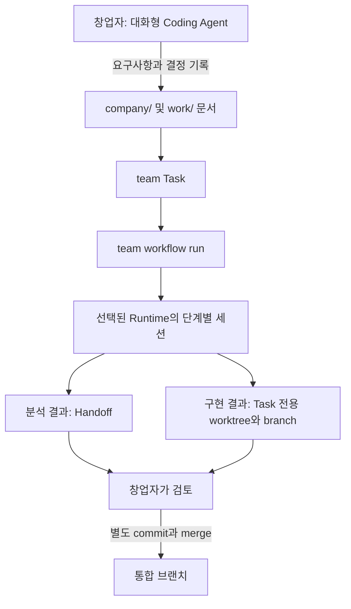
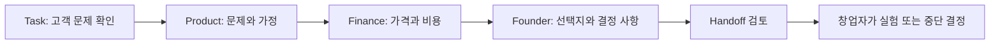
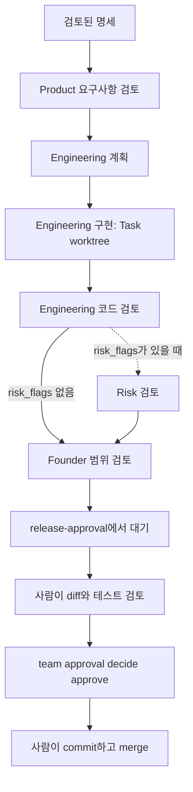

# Harness 운영 가이드: 스톱워치 앱

이 가이드는 1인 개발자가 Agent-Team Harness로 앱을 검증하고 출시하는 방법을 설명한다. 예제 앱은 브라우저용 스톱워치다.

## 문장 기준

이 문서는 ASD-STE100 Issue 9의 핵심 작성 원칙을 한국어에 적용한다. 목표는 원칙의 약 80%를 따르는 것이다. 이 수치는 편집 목표다. 공식 적합성 점수는 아니다.

ASD-STE100은 영어 표준이다. 공식 FAQ는 일부 작성 원칙을 다른 언어 문서에도 적용할 수 있다고 설명한다. 이 문서는 영어 통제 사전과 문법 규칙을 적용하지 않는다. 영어 문장의 단어 수 기준도 한국어에는 직접 적용하지 않는다. 대신 짧은 문장, 한 문단에 한 주제, 능동형 지시문, 일관된 용어를 사용한다.

## 운영 구조

창업자는 대화형 Coding Agent에서 문서와 결정을 관리한다. Harness는 선택한 Coding Agent CLI를 호출해 각 단계를 실행한다.



다음 용어를 이 문서에서 같은 뜻으로 사용한다.

| 용어 | 뜻 |
|---|---|
| Runtime | Harness가 호출하는 Coding Agent CLI 하나 |
| Agent | Product, Finance, Engineering 같은 역할 지침 |
| Task | 완료할 목표와 쓰기 범위를 가진 작업 |
| workflow | Agent와 승인 단계의 실행 순서 |
| Run | workflow를 한 번 실행한 기록 |
| Handoff | Agent 결과를 저장한 구조화 기록 |
| worktree | Task 전용 Git 작업 폴더와 branch |

예제에서는 창업자가 Codex CLI를 대화형으로 사용한다. Harness Runtime도 Codex로 설정한다. 이 설정은 서로 독립이다. Harness Runtime은 Claude Code 또는 Gemini CLI로 바꿀 수 있다.

Harness는 세 CLI를 동시에 라우팅하지 않는다. 프로젝트마다 사용 가능한 CLI 하나를 선택한다. Workflow의 각 단계는 별도 세션으로 실행된다. 앞 단계의 대화 전체는 다음 단계로 전달되지 않는다. Harness는 문서, Task, 검증된 Handoff를 전달한다.

## 1. 준비

필요한 항목은 다음과 같다.

- Node.js 22 이상
- Git 저장소
- 로그인된 Claude Code, Codex 또는 Gemini CLI 중 하나
- 실행 가능한 앱 골격

Harness 저장소에서 아래 명령을 한 번 실행한다.

```bash
cd /path/to/agent-team
npm install
npm run build
npm link
```

제품 코드의 초기 골격은 Harness가 만들지 않는다. 앱이 없으면 Coding Agent로 시작 구조를 만든다. 앱이 실행되는지 확인한다. 다음으로 Git commit을 만든다.

제품 저장소로 이동한다. 작업 시작 상태를 확인한다.

```bash
cd /path/to/stopwatch
git status --short
git log -1 --oneline
```

Task worktree는 현재 commit에서 생성된다. 따라서 앱의 기준 코드는 commit에 있어야 한다.

## 2. Harness를 제품 저장소에 연결

제품 저장소에서 Harness를 초기화한다.

```bash
team doctor
team init --runtime codex
```

`team doctor`는 설치된 Runtime을 확인한다. `team init`은 선택한 Runtime을 설정한다. 이 명령은 `company/`, `knowledge/`, `work/` 시작 파일도 만든다. 기존 파일은 덮어쓰지 않는다.

다른 Runtime을 선택하려면 아래 명령에서 사용할 CLI를 지정한다.

```bash
team runtime set codex  # 또는 claude, gemini
```

### 회사 문서 작성

스톱워치의 현재 사실을 회사 문서에 기록한다.

예제의 범위는 다음과 같다.

- 브라우저에서 시간을 잰다.
- Lap 기록을 화면에 표시한다.
- 로그인, 결제, 서버 저장 기능은 없다.
- 외부 분석과 광고를 사용하지 않는다.

Codex 대화형 세션에서 저장소 문서를 수정한다. 확인되지 않은 내용을 사실로 기록하지 않는다.

```text
company/profile.yaml, company/product.md, company/customers.md를 읽어줘.
확인된 사실과 가정을 따로 정리해줘.
확인되지 않은 고객과 가격 정보를 만들지 마.
스톱워치의 현재 범위도 문서에 반영해줘.
변경 파일과 결정이 필요한 질문을 알려줘.
```

문서를 검토한 뒤 commit한다.

```bash
git add company
git commit -m "docs: record stopwatch product context"
team bootstrap status
```

`team bootstrap status`는 프로필의 `undecided` 값을 표시한다. 모르는 값은 추측하지 않는다.

초기 `team knowledge check`는 검증된 Knowledge Card가 없어 실패할 수 있다. Harness에는 기본 전문 자료가 없다. 필요한 지식은 [Knowledge 운영 안내](./knowledge.md)를 따라 출처와 Card를 추가한다. 현재 workflow는 Knowledge check 결과만으로 실행을 막지 않는다.

## 3. 두 터미널 사용

**터미널 A: 대화형 Coding Agent**

```bash
cd /path/to/stopwatch
codex
```

이 세션에서 제품 요구사항과 `company/`, `work/` 문서를 작성한다. 대화 내용은 Harness에 자동 전달되지 않는다. 결정은 파일에 기록한다.

**터미널 B: Harness 명령**

```bash
cd /path/to/stopwatch
team agents
team runtime show
```

이 터미널에서 Task, Workflow, Handoff와 승인을 관리한다.

`team ask <agent> "질문"`은 한 Agent에게 읽기 전용 의견을 요청한다. 결과는 Agent Result JSON이다. Task나 문서는 자동으로 생성되지 않는다.

`team workflow run`은 저장된 workflow를 실행한다. 결과는 run과 Handoff로 저장된다. Engineering 구현 단계는 Task worktree에 코드를 쓸 수 있다.

## 4. 아이디어 검증

첫 Task에서는 고객 문제와 가장 위험한 가정을 확인한다. 코드를 작성하지 않는다.

Task를 만든다.

```bash
team task create \
  --owner product-growth \
  --objective "스톱워치의 고객 문제와 작은 검증 실험을 정리한다" \
  --why "고객 근거 없이 구현 범위를 늘리지 않기 위해서다"
```

출력된 Task JSON에서 `id`를 복사한다. 아래 예제의 `TASK-ID`를 실제 ID로 바꾼다.

Task를 준비 상태로 바꾼다. Workflow를 확인한 뒤 실행한다.

```bash
team task transition TASK-ID ready
team workflow inspect idea-validation
team workflow run idea-validation --task TASK-ID
```

이 Workflow는 Product, Finance, Founder 순서로 실행된다.



출력의 `runId`를 확인한다. Run과 Handoff를 조회한다.

```bash
team workflow show RUN-ID
team handoff list TASK-ID
```

각 Handoff에서 요약, 근거, 결정, 가정, 위험을 확인한다. Product와 Finance Agent는 `company/product.md`를 자동 수정하지 않는다. 채택할 내용을 사람이 문서에 기록한다.

근거가 부족하면 아래 예처럼 실험 계획을 기록한다.

```markdown
# 스톱워치 문제 검증 — YYYY-MM-DD

## 확인된 근거
- 사용자 인터뷰: 0건
- 사용 행동 관찰: 없음

## 가설
- 일부 사용자는 운동 중 시간과 Lap을 기록하려 한다.
- 설치와 계정 없이 쓰는 앱이 이들에게 편리할 수 있다.

## 다음 단계
- 1주 동안 잠재 사용자 5명에게 현재 사용 방법과 불편을 묻는다.
- 답변의 근거를 기록한다.
- 반복되는 문제가 있는지 확인한 뒤 첫 제품 범위를 정한다.
```

다섯 번의 인터뷰는 탐색 실험이다. 시장 수요를 증명하지 않는다. 결과를 `company/customers.md`와 `company/experiments/`에 기록한다. 결과가 좋지 않으면 가설을 수정하거나 프로젝트를 중단한다.

성공한 Workflow가 끝나면 Task 상태는 `in_review`가 된다. 결과와 창업자 결정을 확인한다. Task를 완료 상태로 바꾼다.

```bash
team task transition TASK-ID completed
```

Agent가 `blocked` 또는 `needs_input`을 반환하면 Task는 멈춘다. 질문의 답을 회사 문서나 명세에 기록한다. 같은 Run을 재개한다.

```bash
team task show TASK-ID
team workflow resume RUN-ID
```

완료한 단계는 다시 실행하지 않는다. 실행 중 Workflow YAML을 바꾸지 않는다. 정의가 바뀌면 같은 Run을 재개할 수 없다. 새 Task와 Run을 만든다.

## 5. 구현 명세 작성

직접 만들기로 결정한 뒤 `work/specs/stopwatch-v1.md`를 작성한다. Engineering Agent는 `work/specs/**`를 읽을 수 있다.

```markdown
# Stopwatch v1

## 목적
브라우저에서 경과 시간과 Lap을 기록한다.

## 범위
- 시작, 일시정지, 재개, 초기화
- Lap 기록과 목록 표시
- 분, 초, 1/100초 표시
- 키보드 조작 지원

## 제외
- 계정, 서버 저장, 결제
- 분석, 광고, 기기 간 동기화

## 수용 조건
- 시작하면 경과 시간이 증가한다.
- 일시정지하면 표시 시간이 멈춘다.
- 재개하면 일시정지한 시간부터 계속 잰다.
- 초기화하면 시간과 Lap 목록을 지운다.
- Lap을 추가하면 최신 기록을 목록 위에 표시한다.
- 주요 조작을 키보드로 실행할 수 있다.

## 검사
- 기존 테스트 명령을 실행한다.
- 시작, 일시정지, 재개, 초기화, Lap 로직을 검사한다.
- 브라우저에서 주요 흐름을 확인한다.

## 구현 경계
- 기존 프레임워크와 구조를 유지한다.
- Task에 지정한 경로만 수정한다.
- 분석 도구와 서버 연결을 추가하지 않는다.
```

요구사항과 구현 제약을 검토한다. 명세를 commit한다.

```bash
git add work/specs/stopwatch-v1.md
git commit -m "docs: define stopwatch v1"
```

## 6. 구현 Workflow 실행

Task에는 목표와 쓸 수 있는 경로를 지정한다. `src/`와 `tests/`는 예제 경로다. 실제 저장소 구조에 맞게 바꾼다.

```bash
team task create \
  --owner engineering \
  --objective "work/specs/stopwatch-v1.md에 따라 구현한다" \
  --why "검토한 제품 범위를 작게 구현하기 위해서다" \
  --write "src/**" \
  --write "tests/**" \
  --forbid production.deploy \
  --forbid external.publish
```

출력된 Task ID를 사용한다. Workflow를 확인하고 실행한다.

```bash
team task transition TASK-ID ready
team workflow inspect feature-delivery
team workflow run feature-delivery --task TASK-ID
```

`feature-delivery`는 다음 순서로 실행된다.



Workflow는 Product 검토와 Engineering 계획 뒤 구현까지 계속 실행한다. 계획 검토 지점에서 멈추지 않는다. 확정 명세는 실행 전에 사람이 검토하고 commit한다.

계획을 먼저 승인해야 하는 큰 변경은 기본 `feature-delivery`에 바로 넣지 않는다. 현재 CLI에는 계획 후 구현 전에 멈추는 승인 지점이 없다.

사전 의견이 필요하면 `team ask`를 사용한다. 이 명령은 읽기 전용이다. 예를 들어 아래 명령은 구현 계획과 위험을 요청한다.

```bash
team ask engineering "이 명세의 변경 계획과 위험을 검토해줘"
```

결과를 사람이 확인한다. 채택한 결정은 명세와 Task에 기록한다.

구현 Agent는 Task 전용 worktree에서만 쓴다. 메인 checkout은 직접 바뀌지 않는다. Product Agent는 Handoff를 작성한다. Product Agent는 명세 파일을 수정하지 않는다.

## 7. 결과 검토와 Git 병합

Workflow 상태와 Handoff를 확인한다.

```bash
team workflow list --task TASK-ID
team workflow show RUN-ID
team handoff list TASK-ID
team task show TASK-ID
```

Task ID의 소문자 형식으로 worktree를 연다. `BASE-COMMIT`은 `.agent-team/engineering-worktrees/task-id.json`의 `baseCommit` 값이다.

```bash
git -C .agent-team/worktrees/task-id status --short
git -C .agent-team/worktrees/task-id diff --check
git -C .agent-team/worktrees/task-id diff BASE-COMMIT
git -C .agent-team/worktrees/task-id ls-files --others --exclude-standard
```

마지막 명령은 Git에 추가하지 않은 파일을 표시한다. `git diff`에는 이 파일이 나오지 않는다. 파일 내용을 직접 연다.

명세의 수용 조건과 diff를 비교한다. 프로젝트 테스트를 실행한다. 브라우저에서 주요 기능도 확인한다.

마지막 `release-approval` 단계에서 Workflow는 승인을 기다린다. Inbox에서 요청을 확인한다.

```bash
team inbox
team approval decide APPROVAL-ID approve --reason "명세, diff와 테스트 결과를 확인했다"
```

승인 artifact는 `company/release-checklist.md`다. 승인 hash는 이 파일에 연결된다. 코드 diff 자체에는 연결되지 않는다. 승인 결정 전에 diff와 테스트를 직접 검토한다.

Harness 승인은 merge나 배포를 하지 않는다. Task worktree에서 commit 상태를 확인한다.

```bash
git -C .agent-team/worktrees/task-id status --short
git -C .agent-team/worktrees/task-id log --oneline --decorate -5
```

Agent가 변경을 commit하지 않았다면, 검토한 파일만 추가해 commit한다.

```bash
git -C .agent-team/worktrees/task-id add src tests
git -C .agent-team/worktrees/task-id commit -m "feat: implement stopwatch v1"
```

메인 checkout에서 통합 브랜치로 이동한다. 예제에서는 브랜치 이름을 `main`으로 사용한다.

```bash
git switch main
git status --short
git merge --no-ff agent-team/task-id
```

`git status`에 예상하지 않은 파일이 있으면 merge하지 않는다. 작업 상태를 먼저 정리한다.

충돌이 나면 해결하고 다시 검사한다. Merge 뒤 앱을 실행하고 수용 조건을 확인한다. Worktree와 branch는 자동 삭제되지 않는다.

## 8. 중단과 주간 업무

Agent가 입력을 요청하면 답을 문서에 기록한다. Workflow를 재개한다.

```bash
team workflow show RUN-ID
team workflow resume RUN-ID
```

승인 요청에서 `request_changes`를 선택하면 Run이 멈춘다. 변경 사항을 반영한 뒤 같은 Run을 재개한다. Harness는 새 승인 artifact hash로 요청을 만든다.

`reject`는 Run을 실패시키고 Task를 취소한다. 코드 branch는 남는다. 사람이 직접 확인한다.

주간 workflow는 운영체제의 cron이나 systemd timer가 `team schedule tick`을 실행해야 시작된다. `team schedule tick`은 초안 Task만 만든다. Coding Agent를 실행하지 않는다.

```bash
team schedule list
team schedule tick
team task show TASK-ID
team task transition TASK-ID ready
team workflow run weekly-operations --task TASK-ID
```

## 9. 현재 기능의 제한

이 가이드는 현재 CLI 구현을 설명한다.

- `team task create`는 담당 Agent, 목표, 이유, 쓰기 경로와 금지 작업을 받는다. 상세 수용 조건은 명세 파일에 기록한다.
- CLI는 Task의 입력 자료, 수용 조건, 검사 항목을 직접 받지 않는다. 이 정보를 명세 파일에 기록한다.
- CLI는 Task 생성 시 `risk_flags`를 받지 않는다. `team risk classify` 결과도 Task에 저장되지 않는다.
- 따라서 CLI로 만든 Task는 `feature-delivery`의 조건부 Risk 검토를 건너뛴다.
- 현재 CLI에는 Risk 검토를 코드 diff에 연결하는 별도 실행 명령이 없다.
- 인증, 결제, 개인정보 변경은 실제 diff를 검토한다. 결과를 `work/risk-reviews/`에 기록한다.
- `team init`은 출처나 검증된 Knowledge Card를 설치하지 않는다.
- Agent 분석 결과는 Handoff에 저장한다. 회사 문서는 사람이 검토해 수정한다.
- Release 승인은 Task와 Run 상태를 갱신한다. Git merge와 배포는 수행하지 않는다.

## ASD-STE100 참고

ASD-STE100 Issue 9는 승인된 용어와 작성 규칙을 포함한 영어 표준이다. 공식 문서는 영어 문장 길이를 절차문 최대 20단어, 설명문 최대 25단어로 정한다. 이 제한은 한국어에 적용하지 않는다.

이 가이드는 짧은 문장, 한 문단에 한 주제, 능동형 문장, 목록과 일관된 용어를 사용한다. 이는 한국어 적용을 위한 편집 기준이다. 표준 전체에 대한 적합성 주장은 아니다.

- [ASD-STE100 Issue 9 공식 문서](https://www.asd-ste100.org/assets/files/ASD-STE100_ISSUE9.pdf)
- [ASD-STE100 공식 FAQ](https://www.asd-ste100.org/STE_faq.html)
